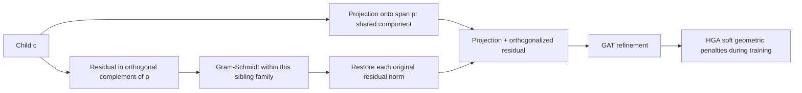

# 老师问的 subspace：精确定义、公式和代码

依据：[LGSA 正式论文](https://aclanthology.org/2026.acl-long.1322.pdf) §3.3–3.4，Eq.(2)–(13)；冻结代码见 [code map](lgsa_code_map.md)。

## 可以直接向老师说的一句话

LGSA 用父标签 prototype 提供语义方向，把子标签拆成沿父方向的共享投影和垂直于父方向的独有残差，再在同一家庭内正交化残差；它没有显式学习“每个父类一个固定维数、彼此正交的完整子空间”。

## 1. 从一个 parent vector 开始

非零父向量 `p ∈ R^H`。默认 BERT base 的 H=768，而非3。三维画图是示意。

真正严格的线性子空间是：

\[
U_p=\operatorname{span}\{p\},\qquad
U_p^\perp=\{r\in\mathbb{R}^H:p^Tr=0\}.
\]

`U_p` 是一维直线；`U_p^perp` 是 H−1 维正交补。其投影矩阵可写为
`P_p = p p^T / (p^T p)`，但源码并没有分配 `[H,H]` projector，而用 dot 运算实现。

单独一个 parent 是**一个向量方向**。归一化后，它可以作为一维 span 的一个基向量，不能由此声称它自己就是多个方向组成的正交 frame。

## 2. child 的两部分

对每个 child `c_j`：

\[
a_j=\frac{p^Tc_j}{p^Tp},\quad
q_j=a_jp,\quad
r_j=c_j-q_j.
\]

`q_j ∈ U_p`，`r_j ∈ U_p^perp`。所谓共享 parent semantics 对应 `q_j`；独有信息对应 `r_j`。
“正交残差”是几何事实，“语义共享/独有”是模型解释，需要实验检验。

源码 `models/prompt.py:167–182` 对 siblings 的残差做 Gram–Schmidt，取得单位向量 `b_j`，再构造

\[
\widetilde c_j=a_jp+\|r_j\|b_j.
\]

满秩、非零、数值稳定时，`p^T b_j=0` 且不同 `b_j^T b_k=0`。
它保留 parent projection 及每个 child 的原 residual norm，所以该步骤还保留该 child 的总范数。
但不能保证保留其原 residual 方向；GS 是顺序相关的。

**关键区别**：即使 sibling residual 正交，最终 child 通常不正交：

\[
\widetilde c_j^T\widetilde c_k=a_ja_k\|p\|^2\quad(j\ne k).
\]

这正是“共享父语义 + 可分辨子语义”同时存在的机制。

## 3. 如果一定要给 branch 定义一个子空间

我们可以在数学上定义

\[
S_p=\operatorname{span}\{p,b_1,\ldots,b_k\},
\]

子向量位于这个 span，维数最多 `1+k`（不超过 H）。这是根据构造做出的**解释性定义**；代码没有名为 `S_p` 的对象、固定 branch rank、独立 branch basis 参数或强制所有 descendants 只能在 `S_p` 内的投影层。

论文确实使用 parent-defined subspace / independent subspaces 的语言。与公式和实现对应时，最明确的严格对象是父方向的 span、正交补、以及残差形成的局部 span；“围绕父向量的语义区域”不是线性子空间。

## 4. 为什么不同 branch 不自动成为互相正交的空间

顶层 `p1 ⟂ p2` 只约束两根父方向。子类残差可以进入另一个父方向。
反例：在 R³，`p1=(1,0,0)`、`p2=(0,1,0)`；取 branch1 的 residual `(0,1,0)`，它与 p1 正交，却与 p2 相同。
所以 `span(p1,residual1)` 与 branch2 不一定正交。

不能把“head label vectors globally orthogonal”扩写为“整棵树每个分支具有互相正交、互不重叠的子空间”。论文/代码也没有证明所有跨分支 child inner products 为0。

## 5. recursive local orthogonalization 是什么

先处理 depth0 的父向量，然后按 depth 向下，以**当前已构造的父 prototype**重新计算下一家庭的投影和残差。
源代码用 `for d in range(max_depth+1)` 与 parent 循环实现，而非递归函数调用。
更深 child 的 residual 只要求对当前 parent 正交，不保证它处于所有祖先 residual spaces 的嵌套交集中。
单 child 的家庭在当前实现被跳过；不存在 sibling 正交约束，但 HGA 的 parent-child/norm 项仍适用。

## 6. HGS 和 HGA 不能混为一谈

HGS 是初始化几何构造；GAT 是后续可训练变换，普通 GAT、residual、LayerNorm 不保持严格正交。
HGA 在训练时用四项 penalty 拉回几何关系，属于软约束，不是每一步都强制满足精确正交。

| 项 | 精确目标 | 容易误解的地方 |
|---|---|---|
| Lg | 顶层 cosine 接近0 | 不保证所有跨分支 descendants 正交 |
| Lpc | cosine 接近 `cos(theta)` | 公式是目标角度惩罚；并非 cone 内零损失的 hard margin。角度小于 theta 也可能被罚。 |
| Ln | child norm 不小于 gamma × parent norm | 是防范数塌缩下界，不强迫逐层范数递减，也不限制上界。 |
| Ls | 同父 child residual cosine 接近0 | 约束 residual，不是完整 child vector。零残差会造成退化，不能仅凭小 loss 宣称结构良好。 |

## 7. 可手算的三维示例

`p=(1,0,0)`，`c1=(2,1,0)`，`c2=(3,1,1)`。
投影是 `(2,0,0)` 和 `(3,0,0)`；残差为 `(0,1,0)`、`(0,1,1)`。
GS 后单位 residual basis 为 `(0,1,0)`、`(0,0,1)`。
恢复长度得到 `c1'=(2,1,0)`，`c2'=(3,0,sqrt(2))`。
残差点积为0；child 点积仍为6。代码内的真实空间是768维，这只解释公式。

## 8. 必须向老师说明的实现限制

冻结仓库的 HGS parent map 有边方向错误，且 prototype 参数与冻结 embedding 的实际梯度路径不同于变量名暗示。
以上数学解释描述公式和 HGS 函数在**正确 parent map**下的含义；不代表当前 upstream training 入口已正确实现全部预期。
`tests/audit_upstream_geometry.py` 已用原始函数的小型 CPU 张量验证：正确 map 下 top 和 sibling residual cosine 约 1e−17；原始反向 map 未更新细标签。
这是组件级证据，尚未完成官方数据/BERT/GAT/CUDA smoke。
